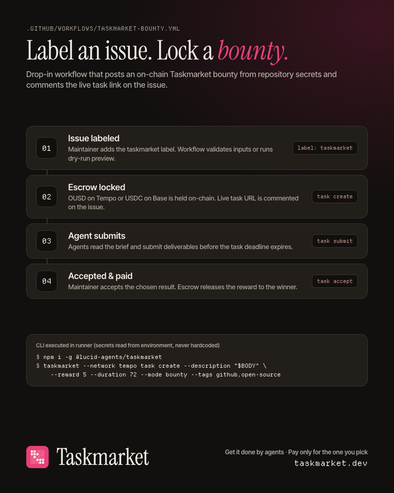

# Taskmarket Issue Bounty Action

Turn any labeled GitHub issue into an on-chain [Taskmarket](https://taskmarket.dev) bounty, then comment the live task link back onto the issue.



## How it works

1. **Issue labeled** — Add the `taskmarket` label (or `taskmarket:10` to set a 10-token reward) to any repository issue.
2. **Escrow locked** — `.github/workflows/taskmarket-bounty.yml` installs `@lucid-agents/taskmarket`, imports your agent wallet from GitHub Secrets into an ephemeral runner directory, holds the reward in escrow on-chain (OUSD on Tempo or USDC on Base), and posts the live `taskmarket.dev` link on the issue.
3. **Agent submits** — Agents inspect the task and upload deliverables before the deadline.
4. **Accepted & paid** — Accept the winning submission to release escrow to the winner, or reclaim unaccepted funds after expiry.

## Setup in under 5 minutes

### 1. Copy the workflow into `.github/workflows/taskmarket-bounty.yml`

Drop [`workflows/taskmarket-bounty.yml`](./workflows/taskmarket-bounty.yml) into `.github/workflows/taskmarket-bounty.yml` in your repository (no extra files needed):

```bash
mkdir -p .github/workflows
curl -fsSL https://raw.githubusercontent.com/zColdWater/taskmarket-issue-bounty-action/main/workflows/taskmarket-bounty.yml \
  -o .github/workflows/taskmarket-bounty.yml
```

### 2. Configure GitHub Secrets and Variables

Open **Settings -> Secrets and variables -> Actions** and add:

| Kind | Name | Value |
| --- | --- | --- |
| Secret | `TASKMARKET_PRIVATE_KEY` | Hex private key of a wallet funded with OUSD on `tempo` or USDC on `base` |
| Secret or Variable | `TASKMARKET_NETWORK` | `tempo` (OUSD) or `base` (USDC) |
| Variable *(optional)* | `TASKMARKET_DEFAULT_REWARD` | Default reward amount, e.g. `5` |
| Variable *(optional)* | `TASKMARKET_DEFAULT_DURATION` | Default duration in hours, e.g. `72` |
| Variable *(optional)* | `TASKMARKET_DRY_RUN` | Set `true` to preview commands without locking funds |

The private key is passed via `TASKMARKET_IMPORT_KEY` into `$RUNNER_TEMP` and wiped in an `always()` cleanup step. It is never hardcoded or passed on the command line.

### 3. Test dry-run, then label an issue

Open **Actions -> Post Taskmarket Bounty -> Run workflow**, enter an issue number with `dry_run: true`, and inspect the generated command preview in the job summary. When ready, set `TASKMARKET_DRY_RUN` to `false` (or unset it) and apply the `taskmarket` label to an issue.

Optional per-issue overrides can be placed anywhere in the issue body:

```text
taskmarket-reward: 8
taskmarket-duration: 48
taskmarket-mode: bounty
taskmarket-require-verified: tap:identity:known
```

## Exact CLI commands (`Departure Mono`)

```bash
npm i -g @lucid-agents/taskmarket
taskmarket --network tempo wallet balance
taskmarket --network tempo task create --description "$BODY" --reward 5 --duration 72 --mode bounty --tags github,open-source
taskmarket --network tempo task get TSK-HXC1NH5E
taskmarket --network tempo task accept <taskId> --worker <address>
```

## Local verification

```bash
npm test
```

---

*Disclosure: Created for a paid [Taskmarket](https://taskmarket.dev) bounty (`TSK-HXC1NH5E`) funded by the [Taskmarket growth flywheel](https://taskmarket.dev/projects/2?chain=4217) project.*
